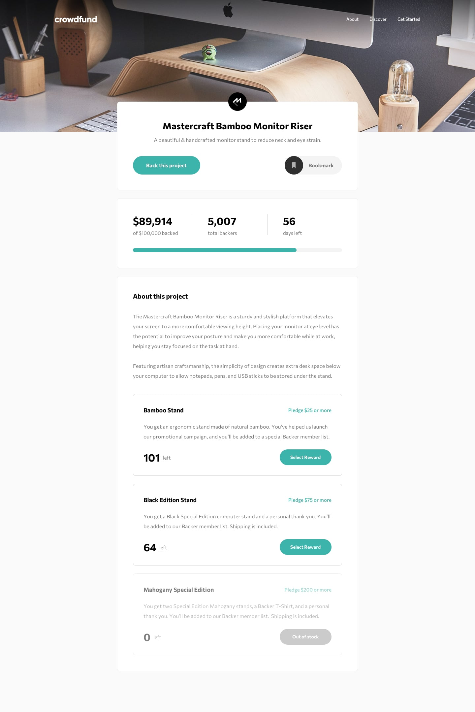
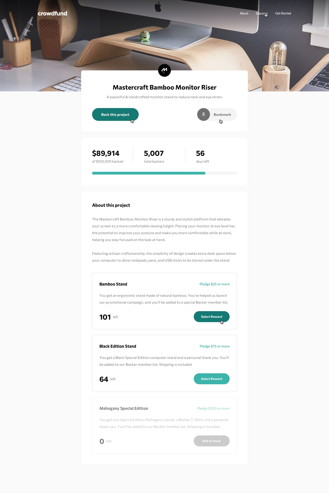
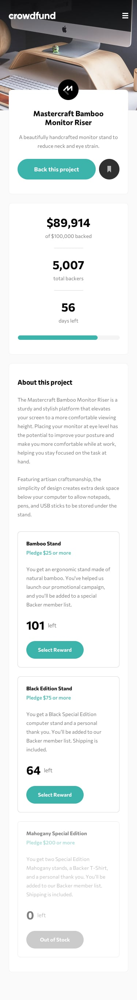
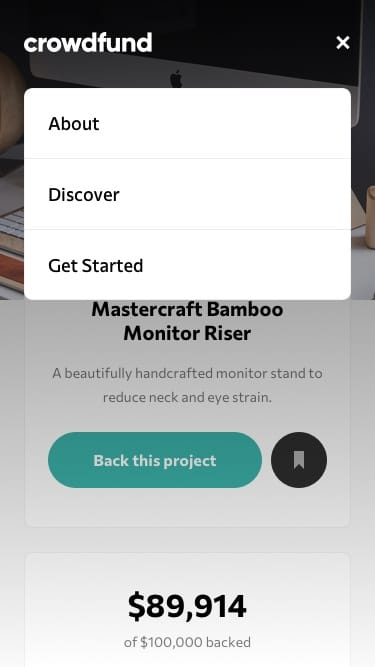
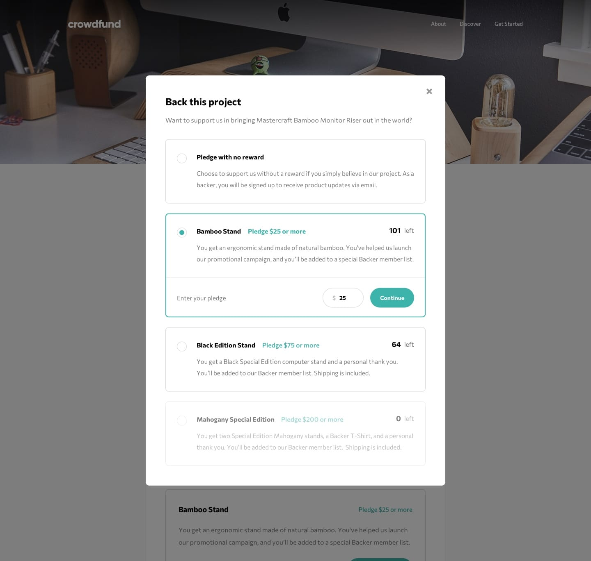

# Frontend Mentor - Solución de la página de crowdfunding

[English](./README.md)

Esta es mi solución al [desafío Crowdfunding Product Page](https://www.frontendmentor.io/challenges/crowdfunding-product-page-7uvcZe7ZR) de Frontend Mentor. Construí una página de producto adaptable con React, Tailwind CSS y Motion. Los visitantes pueden elegir una recompensa, indicar su aporte y ver cómo se actualizan las cifras de la campaña y el inventario.

Los aportes son una simulación en el frontend: los cambios se guardan en el estado de React y se reinician al recargar la página.

---

## Tabla de contenidos

- [Descripción general](#descripción-general)
- [El desafío](#el-desafío)
- [Diseño](#diseño)
- [Enlaces](#enlaces)
- [Mi proceso](#mi-proceso)
- [Tecnologías utilizadas](#tecnologías-utilizadas)
- [Lo que aprendí](#lo-que-aprendí)

---

## Descripción general

La página presenta la campaña de financiación de Mastercraft Bamboo Monitor Riser. Incluye un encabezado adaptable, un botón para guardar el proyecto, estadísticas de la campaña, una barra de progreso, tarjetas de recompensas, un modal de aportación y otro de confirmación.

El visitante puede abrir el modal desde el botón principal o desde una recompensa. Al seleccionar una opción, aparece su formulario y el modal se desplaza hasta ella. Las recompensas agotadas no se pueden seleccionar.

---

## El desafío

Los usuarios deben poder:

- Ver un diseño adaptado a pantallas móviles y de escritorio.
- Abrir y cerrar el menú de navegación móvil.
- Activar y desactivar el marcador del proyecto.
- Elegir un aporte con o sin recompensa.
- Ingresar un monto que cumpla el mínimo de la opción elegida.
- Ver cómo se actualizan el dinero recaudado, el número de patrocinadores y la barra de progreso.
- Ver cómo disminuye en una unidad el inventario de la recompensa seleccionada.
- Identificar las recompensas agotadas, que permanecen deshabilitadas.
- Ver un modal de confirmación después de realizar un aporte.

---

## Diseño

- Diseño de escritorio

- Estados interactivos

- Diseño móvil

- Menú móvil

- Modal con aporte seleccionado

---

## Enlaces

- URL de la solución: [Repositorio en GitHub](https://github.com/mlopezl/crowdfunding-product-page)
- URL del sitio: [Demo en GitHub Pages](https://mlopezl.github.io/crowdfunding-product-page/)
---

## Mi proceso

- Dividí la página en componentes de React para el encabezado, las estadísticas, las recompensas, el formulario y los modales.
- Construí el diseño adaptable con las utilidades de Tailwind CSS.
- Mantuve el total recaudado, el número de patrocinadores, el inventario y la recompensa seleccionada en el estado de React.
- Validé que cada aporte fuera un número entero y cumpliera el mínimo antes de actualizar la campaña.
- Conecté los botones de recompensas con el modal y desplacé la opción elegida hasta quedar visible.
- Añadí una breve animación de aparición a los modales con Motion.
- Configuré Vite para generar el build de GitHub Pages en `docs/` con rutas relativas.

---

## Tecnologías utilizadas

- HTML5 semántico
- React y React Hooks
- Tailwind CSS
- JavaScript (ES6+)
- Motion para React
- Vite
- pnpm
- Diseño adaptable

---

## Lo que aprendí

- A coordinar estados relacionados entre varios componentes de React.
- A validar un aporte antes de modificar los totales y el inventario.
- A mantener sincronizadas las tarjetas y las opciones del modal con los mismos datos de inventario.
- A desplazar una opción seleccionada dentro de un modal.
- A preparar el build de Vite para un sitio de proyecto en GitHub Pages.